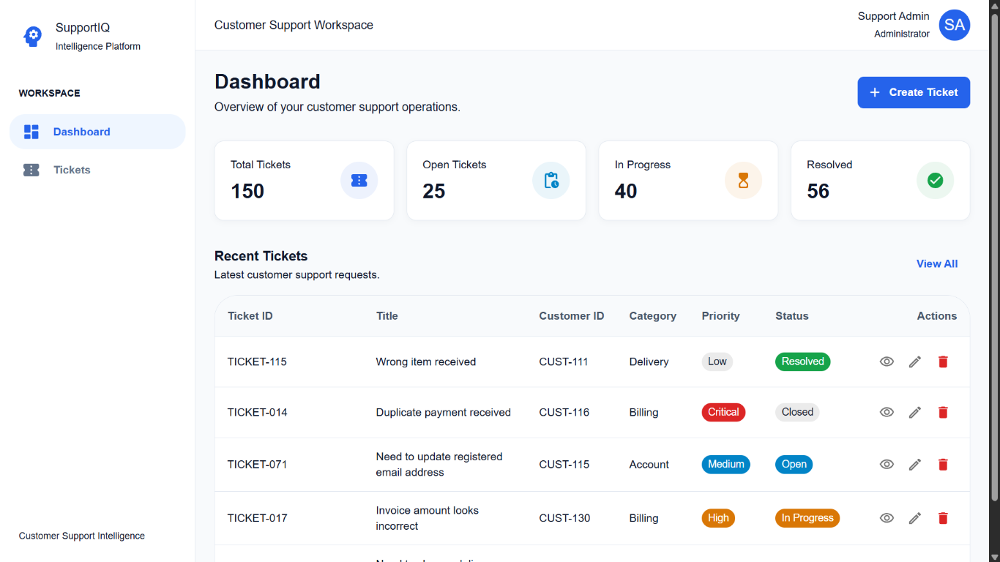
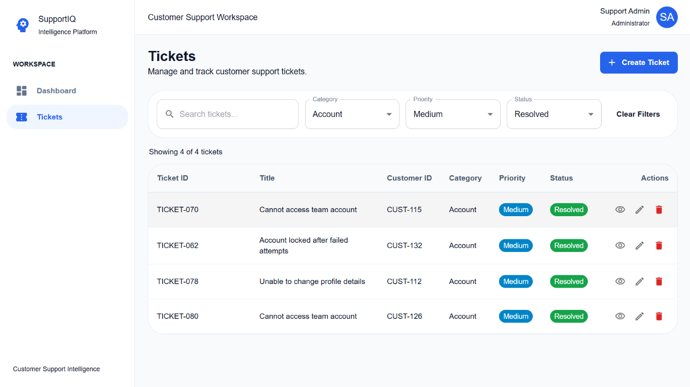
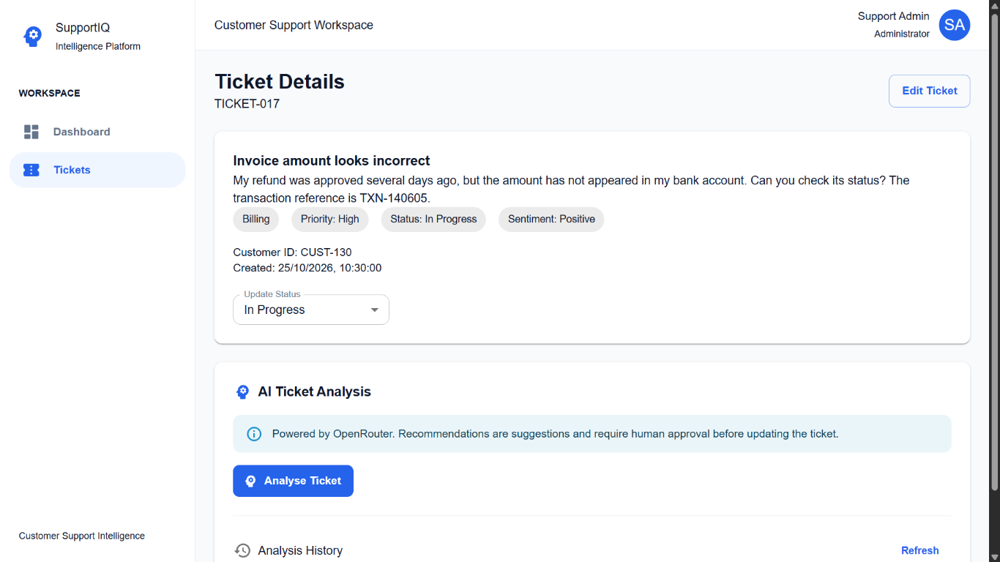
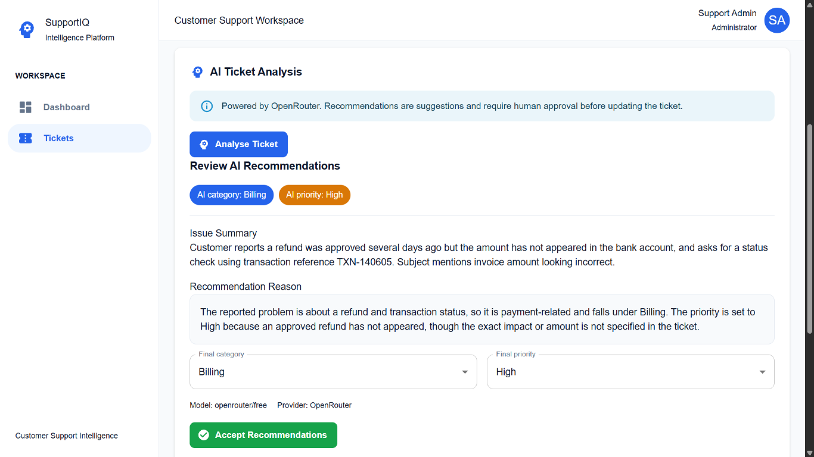
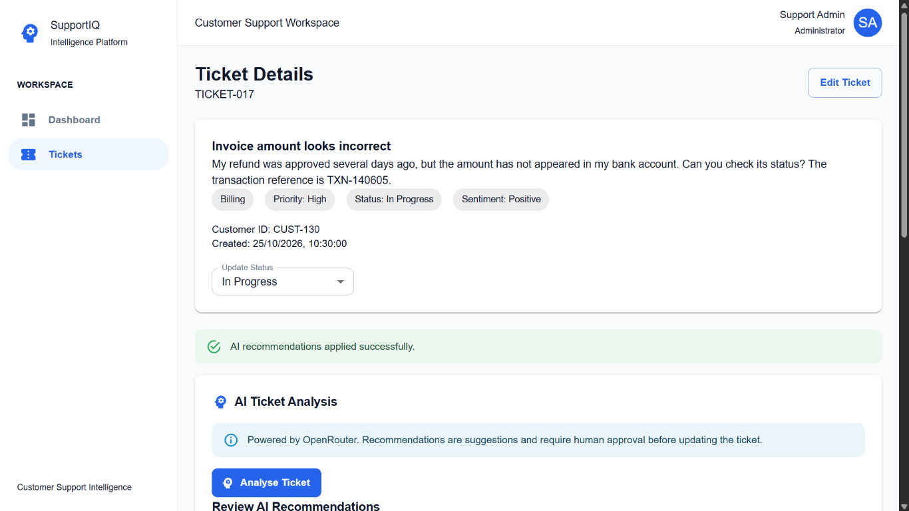
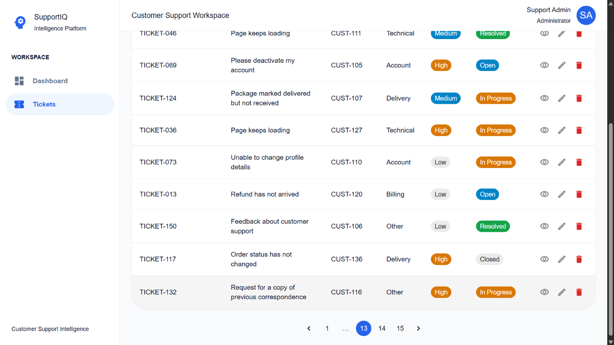

# Customer Support Intelligence Platform

An AI-assisted support ticket application for managing customer requests, reviewing ticket statistics, and generating evidence-based category, priority, summary, and reason recommendations.

## Features

- Create, list, search, filter, retrieve, update, and delete tickets.
- Import the supplied 150-ticket CSV through a validated API endpoint.
- View total, open, in-progress, and resolved ticket counts.
- Analyze tickets with OpenRouter and retain successful analyses in PostgreSQL.
- Review AI recommendations and explicitly accept category and priority changes.
- Keep original ticket data unchanged until a user accepts recommendations.
- Provide generated Swagger UI and OpenAPI documentation.

## Technology

- **Frontend:** React, Vite, JavaScript/JSX, Material UI, React Router, TanStack Query, Axios, React Hook Form, and Zod.
- **Backend:** Python 3.10+, FastAPI, Pydantic, SQLAlchemy, Alembic, and the OpenAI-compatible Python SDK.
- **Database:** PostgreSQL with Psycopg 3.
- **AI:** OpenRouter Chat Completions API (`openrouter/free` by default).
- **Tests:** Pytest and HTTPX for the backend; Vitest and React Testing Library for the frontend.

## Prerequisites

- Python 3.10 or later.
- Node.js 20.19+ (or 22.12+) and npm.
- PostgreSQL and `psql` command-line tools.
- An OpenRouter API key to use live AI analysis. Ticket CRUD does not require the key.

## Local setup

### 1. Create the PostgreSQL database

Create a local database (adjust the role for your PostgreSQL installation):

```powershell
psql -U postgres -c "CREATE DATABASE customer_support_db;"
```

### 2. Configure and run the backend

Run these commands from the repository root:

```powershell
Set-Location backend
python -m venv .venv
.\.venv\Scripts\Activate.ps1
python -m pip install -r requirements.txt
```

On first setup, copy `backend/.env.example` to `backend/.env`; do not overwrite an existing `.env`. Set `DATABASE_URL` to your local PostgreSQL connection. Set `OPENROUTER_API_KEY` on the backend only to enable AI analysis. The example contains placeholders, not credentials.

```powershell
alembic upgrade head
uvicorn app.main:app --reload
```

The backend listens at `http://127.0.0.1:8000`. To import the supplied CSV, use a second terminal from the `backend` directory:

```powershell
curl.exe -X POST http://127.0.0.1:8000/api/v1/tickets/import -F "file=@..\dataset\customer_support_tickets_sample_150.csv"
```

CSV import upserts by ticket ID. Re-importing the file updates matching records, so do not re-import if you want to preserve changes made to those tickets.

### 3. Run the frontend

```powershell
Set-Location frontend
npm ci
```

The API client defaults to `http://127.0.0.1:8000/api/v1`. To override it, copy `frontend/.env.example` to `frontend/.env.local` and edit `VITE_API_BASE_URL`. Then run:

```powershell
npm run dev
```

Vite prints the local frontend URL (normally `http://localhost:5173`). The backend `CORS_ORIGINS` setting must include that origin.

## Database migrations

Alembic migrations are in `backend/migrations/versions/`. Apply them from `backend/` after configuring the database:

```powershell
alembic upgrade head
```

The current schema has `tickets` and `ai_analyses`; the latter references the former. See [the ER diagram](docs/database-erd.md). Migration history is retained; no tables are created by manually editing a production database.

## API and examples

FastAPI generates the API reference from the actual routes and schemas:

- Swagger UI: <http://127.0.0.1:8000/docs>
- ReDoc: <http://127.0.0.1:8000/redoc>
- OpenAPI JSON: <http://127.0.0.1:8000/openapi.json>
- Health check: <http://127.0.0.1:8000/api/v1/health/>

Main endpoints:

| Method | Path | Purpose |
|---|---|---|
| `POST` | `/api/v1/tickets/` | Create a ticket |
| `GET` | `/api/v1/tickets/` | List, search, filter, sort, and paginate tickets |
| `GET` | `/api/v1/tickets/{ticket_id}` | Retrieve a ticket |
| `PUT` | `/api/v1/tickets/{ticket_id}` | Update ticket fields |
| `DELETE` | `/api/v1/tickets/{ticket_id}` | Delete a ticket |
| `POST` | `/api/v1/tickets/import` | Import a CSV file |
| `POST` | `/api/v1/tickets/{ticket_id}/analyze` | Generate and save an AI analysis |
| `GET` | `/api/v1/tickets/{ticket_id}/analyses` | Read analysis history |
| `POST` | `/api/v1/tickets/{ticket_id}/analyses/{analysis_id}/accept` | Apply an analysis's category and priority |

Example ticket creation request:

```json
{
  "ticket_id": "TICKET-EXAMPLE-001",
  "customer_id": "CUST-001",
  "subject": "Payment failed",
  "description": "The payment was declined when I tried to renew.",
  "created_at": "2026-01-15T10:30:00",
  "status": "Open",
  "category": "Billing",
  "priority": "Medium",
  "sentiment": "Negative",
  "resolution": null
}
```

Example filtered list request:

```text
GET /api/v1/tickets/?search=payment&category=Billing&priority=High&status=Open&page=1&page_size=10
```

An AI analysis request has no body. A successful response includes the recommendation, summary, reason, provider/model metadata, and a persisted analysis ID. Call the `accept` endpoint only after a person reviews the recommendation; it updates the ticket's category and priority. The complete request/response schemas are in Swagger/OpenAPI.

## Architecture and data notes

- [Architecture diagram and request flow](docs/architecture.md)
- [Database ER diagram](docs/database-erd.md)
- [Technical note, data-label handling, limitations, and future work](docs/technical-note.md)

The supplied dataset and the assignment use different category/status labels. The application preserves imported values rather than silently rewriting existing records; the actual values and limitations are documented in the technical note.

## Tests and checks

Run backend commands from `backend/` with the virtual environment active:

```powershell
python -m pytest tests/ -v
python -m compileall -q app tests
```

The database integration tests use the configured PostgreSQL database. OpenRouter requests are mocked in automated tests; tests do not consume provider quota.

Run frontend commands from `frontend/`:

```powershell
npm test
npm run lint
npm run build
```

## Application Screenshots

**Dashboard and ticket statistics**



**Ticket listing, search and filters**



**Individual ticket details**



**AI recommendations with editable category and priority before acceptance**



**Accepted recommendations and updated ticket**



**Ticket-list pagination**



## AI coding-tool disclosure

GitHub Copilot was used as an AI coding assistant during implementation. The project owner should review the final diff and be prepared to explain the implementation and trade-offs.
