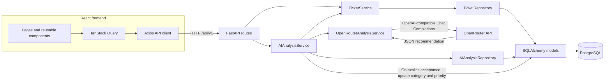

# Application architecture

## Request flow

1. React pages use TanStack Query for server state and the shared Axios client for HTTP requests.
2. FastAPI routes validate request and response data with Pydantic schemas and call the corresponding service.
3. Ticket CRUD uses `TicketService` and `TicketRepository`; repositories perform database access through SQLAlchemy.
4. The AI analysis route calls `AIAnalysisService`, which retrieves the ticket, calls `OpenRouterAnalysisService`, validates the JSON result, then persists only a valid successful result through `AIAnalysisRepository`.
5. Analysis history is read from PostgreSQL. The ticket is not changed by analysis generation. A separate acceptance request applies the stored category and priority after a person chooses to accept.

The acceptance service currently assigns the accepted recommendations to the loaded SQLAlchemy `Ticket` and commits the session directly; it does not route that specific update through `TicketRepository`. The diagram reflects this existing behavior rather than implying a repository call that is not present.

