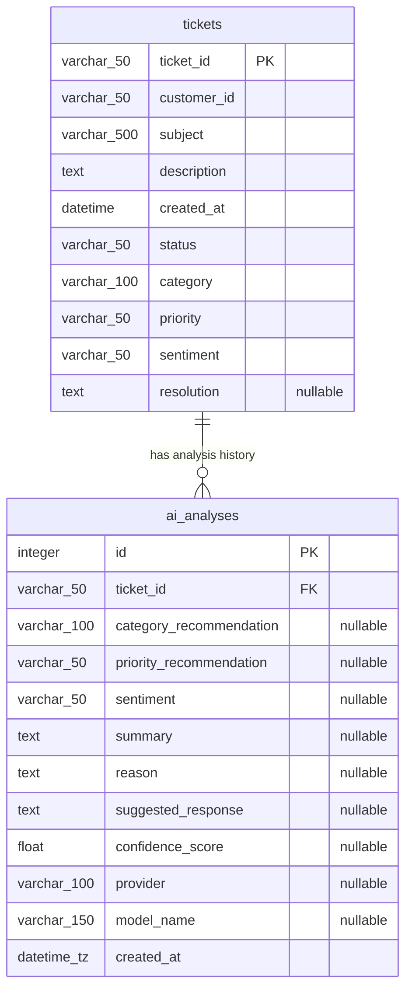

# Database entity relationship diagram

This diagram reflects the SQLAlchemy models and migrations in `backend/app/models/` and `backend/migrations/versions/`. It shows application tables only; Alembic's version bookkeeping is migration metadata, not a domain entity.

## Relationship and schema notes

- `tickets.ticket_id` is the ticket primary key.
- `ai_analyses.id` is an auto-incrementing primary key.
- `ai_analyses.ticket_id` is a non-null foreign key to `tickets.ticket_id`, with database `ON DELETE CASCADE` and an ORM `all, delete-orphan` relationship.
- A ticket may have zero or more analysis records; each analysis belongs to one ticket.
- `ai_analyses.reason` was added by a follow-up Alembic migration and is nullable to preserve existing rows.
- The ticket model indexes `customer_id`, `created_at`, `status`, `category`, and `priority`, and defines a composite `(status, priority)` index. `ai_analyses.ticket_id` is indexed.
- Recommendation history is stored in `ai_analyses`; there is no AI summary column on `tickets`.
- Category, priority, and status columns are strings, not database enums or check constraints. Application choices/AI response validation are described in the [technical note](technical-note.md).

